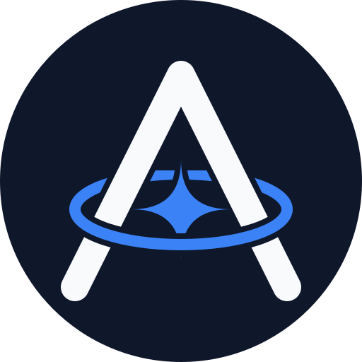

<p align="center">
  
</p>

<h1 align="center">AsterYggdrasil</h1>

<p align="center">
  A self-hosted Minecraft skin site and Yggdrasil/authlib-injector authentication server in Rust.
  <br />
  Site accounts, player profiles, launcher login, join/hasJoined verification, skin and cape hosting, and a public texture library — one dual-licensed single-binary service built on AsterForge.
</p>

<p align="center">
  <a href="https://yggdrasil.astercosm.com/"></a>
  <a href="README.zh.md"></a>
  <a href="docs/en/guide/getting-started.md"></a>
  <a href="docs/en/guide/launcher-setup.md"></a>
  <a href="docs/en/deployment/docker.md"></a>
  <a href="developer-docs/README.md"></a>
  
  
</p>

## What is AsterYggdrasil?

AsterYggdrasil is a self-hosted identity and texture service for private Minecraft deployments, built on the [AsterForge](https://github.com/AsterCommunity/AsterForge) runtime. It covers the full skin-site workflow: site accounts with captcha-protected auth flows, Minecraft player profiles, launcher login through the Yggdrasil/authlib-injector protocol, server join verification, skin and cape uploads with PNG re-encoding, hash-based public texture reads, a moderated public texture library, and scoped admin/operator workflows.

It focuses on the Minecraft/Yggdrasil domain. It is not a Minecraft server manager, not a Mojang replacement for arbitrary online-mode clients, and not a plugin ecosystem.

## Where it fits

AsterYggdrasil is a good fit when you:

- operate Minecraft servers in the authlib-injector or offline-login ecosystem and want your own auth source
- want full control of player accounts, profiles, texture files, signing keys, the database, and backups
- need Yggdrasil/authlib-injector-compatible protocol endpoints your launchers already speak
- want to start with SQLite and local storage, then move to PostgreSQL/MySQL and S3/MinIO later
- want a single Rust binary with an embedded frontend instead of a PHP runtime stack
- want a codebase meant to be read, modified, and self-deployed

It is probably not the right first choice when you need:

- a commercial-grade operations panel validated for large public traffic, without your own review
- client-side presigned uploads to S3/MinIO (uploads are server-side streaming)
- multi-instance high availability with automatic failover
- Minecraft server lifecycle management (world hosting, plugins, console)
- a public replacement for Mojang online-mode auth

## Capabilities

- **Site accounts** — registration, login, refresh, logout, first-admin setup, invitations, contact-verification flows, passkeys, external authentication (GitHub/Google/QQ/OIDC), bans, and scoped operators.
- **Yggdrasil protocol** — `authenticate`/`refresh`/`validate`/`invalidate`/`signout`, `join`/`hasJoined`, profile lookup, and signed texture properties with a rotatable signing key.
- **Minecraft profiles** — multiple profiles per account, controlled renames that keep UUIDs and textures while invalidating launcher tokens.
- **Textures** — skin/cape upload with PNG re-encoding and dimension checks, legacy cape compatibility, hash-addressed public reads, local/S3/MinIO storage, and forwarded-texture URLs for session-forward servers.
- **Texture library** — public submission, review/publish/unpublish moderation, tags, copying to wardrobe, and reporting.
- **Operations** — runtime config with hot reload, background tasks with health reporting, Prometheus metrics, CSRF/security headers/rate limiting, and structured error codes.

## Quick start

### Run from source

```bash
git clone https://github.com/AsterCommunity/AsterYggdrasil.git
cd AsterYggdrasil
cargo run
```

The server boots with SQLite and local storage, seeds defaults, and prints the listen address. The embedded frontend is served from the same port; the Yggdrasil API root lives at `/api/yggdrasil`.

### Docker

See [docs/en/deployment/docker.md](docs/en/deployment/docker.md) for the container deployment and volume layout.

### Configure a launcher

Point your authlib-injector launcher at `http://<host>:<port>/api/yggdrasil` (or your reverse-proxied domain). See [launcher setup](docs/en/guide/launcher-setup.md) for per-launcher instructions.

## Documentation

- [Documentation site](https://yggdrasil.astercosm.com/) — Chinese-first, English under `docs/en/`
- [Getting started](docs/en/guide/getting-started.md) · [launcher setup](docs/en/guide/launcher-setup.md) · [profiles](docs/en/guide/profiles.md) · [configuration](docs/en/guide/configuration.md)
- [Admin guide](docs/en/guide/admin-guide.md) · [background tasks](docs/en/guide/audit-tasks.md) · [user bans](docs/en/guide/user-bans.md)
- [Docker deployment](docs/en/deployment/docker.md) · [example config](config.example.toml)
- [Developer docs](developer-docs/README.md) · [OpenAPI export](tests/generate_openapi.rs) (`cargo test --features openapi --test generate_openapi`)

## Development

```bash
# backend
cargo check
cargo test --workspace --lib
cargo clippy --workspace --all-features

# frontend
cd frontend-panel
bun install
bun run check
bun run test

# docs site
cd docs && bun install && bun run dev
```

Project layout: the `aster_yggdrasil` crate owns the application (API, services, runtime assembly); `aster_yggdrasil_model` owns SeaORM entities and domain types; `aster_yggdrasil_migration` owns database migrations; `aster-texture-renderer` renders skin previews. Shared runtime mechanics come from [`AsterForge`](https://github.com/AsterCommunity/AsterForge) crates pinned on crates.io.

## License

Dual-licensed under [MIT](LICENSE-MIT) or [Apache-2.0](LICENSE-APACHE), at your option.
