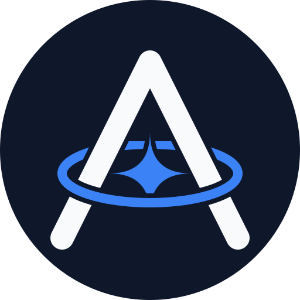

<p align="center">
  
</p>

<h1 align="center">AsterYggdrasil</h1>

<p align="center">
  基于 Rust 的自托管 Minecraft 皮肤站与 Yggdrasil/authlib-injector 认证服务器。
  <br />
  站点账号、玩家档案、启动器登录、join/hasJoined 验证、皮肤与披风托管、公共材质库——一个基于 AsterForge 的双许可单二进制服务。
</p>

<p align="center">
  <a href="https://yggdrasil.astercosm.com/"></a>
  <a href="README.md"></a>
  <a href="docs/guide/getting-started.md"></a>
  <a href="docs/guide/launcher-setup.md"></a>
  <a href="docs/deployment/docker.md"></a>
  <a href="developer-docs/README.md"></a>
  
  
</p>

## AsterYggdrasil 是什么？

AsterYggdrasil 是面向 Minecraft 私有部署的自托管身份与材质服务，构建在 [AsterForge](https://github.com/AsterCommunity/AsterForge) 运行时之上。覆盖皮肤站的完整工作流：带图形验证码保护的站点账号认证、Minecraft 玩家档案、Yggdrasil/authlib-injector 协议的启动器登录、服务器 join 验证、带 PNG 重编码的皮肤/披风上传、基于哈希的公开材质读取、带审核流程的公共材质库，以及分权 admin/operator 管理工作流。

它专注 Minecraft/Yggdrasil 域：不是 Minecraft 服务器管理器，不是面向任意在线模式客户端的 Mojang 替代品，也不是插件生态。

## 当前适合谁

适合你的情况：

- 你在 authlib-injector 或离线登录生态运营 Minecraft 服务器，想要自己的认证源
- 你想完全掌控玩家账号、档案、材质文件、签名密钥、数据库和备份
- 你需要启动器已经支持的 Yggdrasil/authlib-injector 兼容协议端点
- 你想从 SQLite + 本地存储起步，后续迁移到 PostgreSQL/MySQL 和 S3/MinIO
- 你想要单 Rust 二进制内嵌前端的部署模型，而不是 PHP 运行时栈
- 你想要一个可阅读、可修改、可自部署的 Rust + React 代码库

可能不适合的情况：

- 需要未经自己验证、可直接承载大规模公开流量的商业级运营面板
- 需要 S3/MinIO 的客户端直传（当前上传是服务端流式）
- 需要多实例高可用与自动故障转移
- 需要 Minecraft 服务器生命周期管理（世界托管、插件、控制台）
- 需要替代 Mojang 官方在线模式认证的公共服务

## 能力总览

- **站点账号**：注册、登录、刷新、登出、首个管理员初始化、邀请、联系方式验证流程、Passkey、外部认证（GitHub/Google/QQ/OIDC）、封禁、分权 operator。
- **Yggdrasil 协议**：`authenticate`/`refresh`/`validate`/`invalidate`/`signout`、`join`/`hasJoined`、profile 查询，以及带可轮换签名密钥的材质属性签名。
- **Minecraft 档案**：每账号多档案，受控改名保持 UUID 与材质绑定并失效启动器令牌。
- **材质**：皮肤/披风上传（PNG 重编码、尺寸校验）、旧版披风兼容、哈希寻址公开读取、本地/S3/MinIO 存储、session-forward 的材质 URL 重写。
- **材质库**：公开投稿、审核/发布/下架、标签、复制到衣柜、举报。
- **运维**：运行时配置热更、带健康上报的后台任务、Prometheus 指标、CSRF/安全头/限流、结构化错误码。

## 快速开始

### 从源码运行

```bash
git clone https://github.com/AsterCommunity/AsterYggdrasil.git
cd AsterYggdrasil
cargo run
```

默认以 SQLite 和本地存储启动，写入默认配置并打印监听地址。内嵌前端由同一端口提供；Yggdrasil API 根路径在 `/api/yggdrasil`。

### Docker

容器部署与卷布局见 [docs/deployment/docker.md](docs/deployment/docker.md)。

### 接入启动器

把 authlib-injector 启动器的认证地址指向 `http://<host>:<port>/api/yggdrasil`（或你的反向代理域名）。各启动器的接入说明见[启动器接入指南](docs/guide/launcher-setup.md)。

## 文档

- [文档站](https://yggdrasil.astercosm.com/) · [英文文档](docs/en/index.md)
- [快速开始](docs/guide/getting-started.md) · [启动器接入](docs/guide/launcher-setup.md) · [玩家档案](docs/guide/profiles.md) · [配置说明](docs/guide/configuration.md)
- [管理员指南](docs/guide/admin-guide.md) · [后台任务](docs/guide/audit-tasks.md) · [用户封禁](docs/guide/user-bans.md)
- [Docker 部署](docs/deployment/docker.md) · [配置示例](config.example.toml)
- [开发者文档](developer-docs/README.md) · [OpenAPI 导出](tests/generate_openapi.rs)（`cargo test --features openapi --test generate_openapi`）

## 开发

```bash
# 后端
cargo check
cargo test --workspace --lib
cargo clippy --workspace --all-features

# 前端
cd frontend-panel
bun install
bun run check
bun run test

# 文档站
cd docs && bun install && bun run dev
```

项目布局：`aster_yggdrasil` 主 crate 承载应用（API、服务、运行时装配）；`aster_yggdrasil_model` 承载 SeaORM 实体与领域类型；`aster_yggdrasil_migration` 承载数据库迁移；`aster-texture-renderer` 负责皮肤预览渲染。共享运行时机制来自 crates.io 上精确锁定的 [`AsterForge`](https://github.com/AsterCommunity/AsterForge) crate。

## 许可证

采用 [MIT](LICENSE-MIT) 或 [Apache-2.0](LICENSE-APACHE) 双许可，任选其一。
